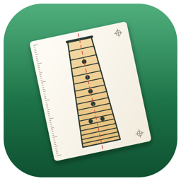
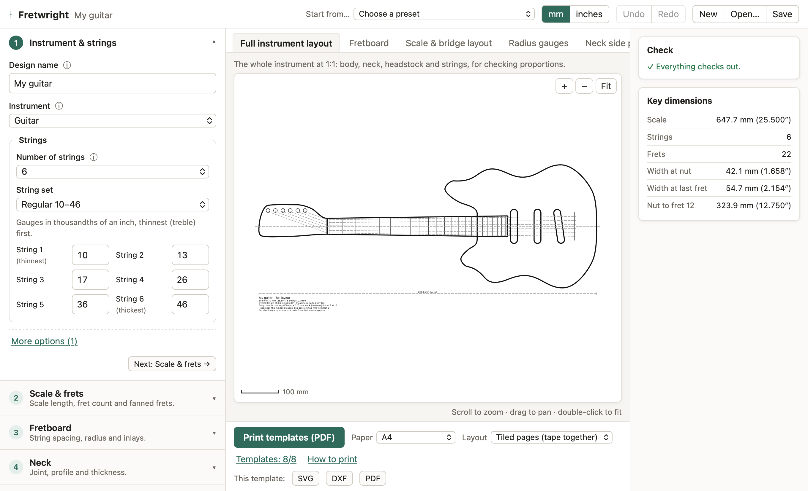

# Fretwright

Design an electric guitar or bass from a few parameters and print accurate **1:1 paper templates**:
fretboard with fret slots, scale and bridge layout, radius gauges, neck profiles, headstock and body.
Runs in the browser, nothing to install.

Inspired by [MarzWorkbench](https://github.com/mnesarco/MarzWorkbench), a FreeCAD workbench, rebuilt as a
standalone app that is easier to use: presets, plain-language validation, live preview and tiled PDF output.



## Download

Desktop apps are on the [Releases](https://github.com/martwyymem/fretwright/releases) page. They are the same app
in a native window: they work offline and keep your design between launches.

| Platform | File | Notes |
|---|---|---|
| macOS 26 or later (Apple silicon and Intel) | `Fretwright-<version>-macOS.zip` | Unsigned: first launch with right-click → Open |
| Windows 10/11 (x64 or ARM) | `Fretwright-<version>-windows-x64.zip` / `-arm64.zip` | Portable `.exe`; uses the Edge WebView2 runtime built into Windows. SmartScreen may ask: More info → Run anyway |
| Linux | `Fretwright-<version>-x86_64.flatpak` | `flatpak install --user Fretwright-<version>-x86_64.flatpak` |

## Develop

```sh
npm install
npm run dev     # http://localhost:5173
npm test
npm run build   # static site in dist/
```

See [docs/ARCHITECTURE.md](docs/ARCHITECTURE.md) for the conventions.

## Desktop builds

Each desktop app is a thin native shell around the built web app (`dist/`), with no Electron:

| Command | Output | Shell | Build on |
|---|---|---|---|
| `npm run build:mac` | `build/Fretwright.app`, `build/Fretwright-<v>-macOS.zip` | Swift + WKWebView (`macos/`) | macOS with Xcode 26+ |
| `npm run build:windows` | `build/windows/Fretwright-<v>-windows-{x64,arm64}.zip` | Go + WebView2 (`windows/`) | any OS with Go (cross-compiles) |
| `npm run build:flatpak` | `build/linux/Fretwright-<v>.flatpak` | Python + GTK 4 + WebKitGTK (`linux/`) | Linux with flatpak-builder |

[`.github/workflows/desktop.yml`](.github/workflows/desktop.yml) builds all three on every push, launches each
one in a self-test (`FRETWRIGHT_SELFTEST=<dir>`: page loads, autosave survives a relaunch, SVG/DXF/PDF exports
save), and attaches the files to the release when a tag is pushed.

The macOS build is ad-hoc signed; set `CODESIGN_IDENTITY="Developer ID Application: …"` and notarize to ship it
without the Gatekeeper prompt. The Windows `.exe` is unsigned.

Icons live in [`assets/icon/`](assets/icon): `fretwright.svg` (Windows, Linux, web) and `fretwright-macos.svg`
(macOS icon grid) are the sources; `render.sh` regenerates the `.icns`, `.ico` and PNGs.

## License

GPL-3.0-or-later. See [LICENSE](LICENSE).
